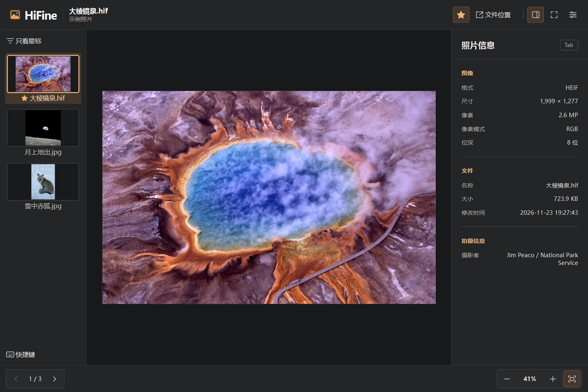

# HiFine

拍了一卡照片，回家就想挑张没糊的。双击第一张，按 **→**，没动静。关窗口，回文件夹，再双击第二张。照这个挑法，我的鼠标得比快门先退休。

换了几个看图软件，想顺手删张废片，还得回文件夹猜刚才看的是 `DSC_0421` 还是 `DSC_0422`。有些软件的收费按钮倒是一眼就能找到。这窝囊气谁爱受谁受，我喊 AI 开工了。😡

代码从头到尾都是 AI 写的，我负责拿照片试，哪儿难用就揪它回来改。要是哪行代码看着邪门，咱俩可以一起听它狡辩。

**[GitHub 免费下载][latest-release] · [Mirror 酱高速下载][mirror-download] · [MIT 开源](LICENSE)**

## 拿它挑片

- **用方向键翻完整个文件夹。** 双击一张照片，按 ← 或 ↑ 看上一张，按 → 或 ↓ 看下一张。相机拍的 HIF、HEIF、HEIC 可以直接看，平时的 JPG、PNG 和动图也能开。
- **连拍来回比，少等几回。** 双击人眼就能看原大，也可以用滚轮放大。想盯着同一处比几张连拍，可以在「设置 → 图片浏览」勾选「翻图时保留缩放倍率和查看位置」，然后用方向键来回翻。默认翻页看全图。HiFine 会提前读相邻的照片，按 Tab 还能看快门、光圈和 ISO。
- **左边一溜缩略图，挑好几张一起收拾。** 按住 Ctrl（Mac 上是 ⌘）挨个点，按住 Shift 点最后一张就能连选一段。选中的照片可以一起复制、剪切，或是送进回收站。从别的文件夹复制来的照片也能直接粘贴进来，碰上同名的会自动加序号。记不住快捷键，点缩略图底下的多选按钮就能查。
- **右键就能管文件。** 右键选中的缩略图，一次操作整组。想单独收拾旁边那张糊片，直接右键它，眼前的大图还能留着作对照。Windows 上弹出的就是资源管理器的原生菜单。
- **看中了哪张，按回车就能找到原文件。** 想接着挑另一个文件夹，把里面任意一张照片拖进窗口就行。手边没照片？直接启动 HiFine，还有三张示例可以试试。

至于以后加什么，得看我下回拍完照又被什么事惹毛了。

## 安装与双击打开

在最新版发布页挑自己系统的安装包就行。[去 GitHub 下载][latest-release]

- **Windows x64** 选 `setup.exe` 结尾的。装好后右键一张照片，在“打开方式”里选 HiFine 并设为默认，以后双击就能看。
- **macOS 14 及以上** 用 M 系列芯片的选 `arm64.dmg`，用 Intel 的选 `x86_64.dmg`，打开后把 HiFine 拖进“应用程序”。首次打开若提示无法验证，可以在“系统设置 → 隐私与安全性”里点“仍要打开”。
- **Ubuntu 24.04（64 位 PC）** 选 `linux-amd64.deb`。

HiFine 的所有看图功能装好就能用，去 GitHub 下载和更新都免费。Mirror 酱提供可选的付费下载加速。已经有 CDK 的朋友可以在“设置 → 软件更新”里填上，发现新版时就会自动下载安装包。谢谢愿意花钱加速、顺手支持作者的各位！

[latest-release]: https://github.com/MistEO/HiFine/releases/latest
[mirror-download]: https://mirrorchyan.com/zh/projects?rid=HiFine
